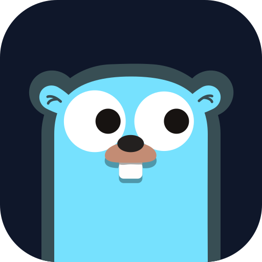

<p align="center">
  
</p>

<h1 align="center">Burrow</h1>

<p align="center">
  A self-hosted, AI-powered tutor for learning Go.<br>
  Lessons, quizzes, coding drills, spaced repetition and a daily quiz on your phone, all running on your own server.
</p>

---

## Features

- **Structured course**: 32 topics in 7 modules, from the toolchain to concurrency, generics, iterators and runtime internals such as the GMP scheduler.
- **AI lessons** generated for each topic on demand, tailored to your background, and streamed as they are written.
- **Quizzes** with single-choice, multi-choice and open questions. Choice answers are graded instantly; open answers are graded by the AI with feedback. New questions avoid repeats and probe your past mistakes.
- **Inline hints**: up to three progressively stronger hints right under the question, and an in-depth explanation of your answer afterwards.
- **Nothing gets lost**: lessons, quizzes and drills are generated in the background, so you can leave the page and get notified when they are ready. Every quiz is saved and can be resumed, and answer drafts and drill code are autosaved.
- **Coding drills**: the AI writes an exercise with hidden tests, the server checks that the reference solution passes before showing it to you, and your code runs with `go test` in a sandboxed temp module.
- **Spaced repetition (FSRS)** schedules every answered question for review at the right time.
- **Daily quiz**: due reviews plus fresh questions on your weakest topics, built automatically every day, with Web Push notifications.
- **Ask anything**: a chat with your AI mentor, with one-click "explain this" and "give me a hint" from any question or drill.
- **Progress tracking**: mastery per topic and module, streaks, accuracy and a 4-week activity heatmap.
- **Installable PWA** that works on desktop and mobile, with One Light / One Dark themes and an English or Russian interface.

## Bring your own AI

Every AI feature goes through a provider you configure in **Settings**. You can mix them per task (chat, content generation, grading).

| Provider | What it uses | Billing |
| --- | --- | --- |
| **ACP agent** | [Agent Client Protocol](https://agentclientprotocol.com) agents: `codex-acp` (ChatGPT plan), `claude-agent-acp` (Claude plan), Gemini CLI | Your existing subscription |
| **Anthropic API** | Claude models via the official SDK, structured outputs | Per token |
| **OpenAI-compatible API** | OpenAI, OpenRouter, Ollama, LM Studio, anything with `/v1/chat/completions` | Per token, or free when local |

ACP agents run as long-lived subprocesses with no file system or terminal access; every tool permission request is rejected.

## Stack

- **Backend**: Go, SQLite (`modernc.org/sqlite`, no CGO), `sqlc`, `goose` migrations.
- **Frontend**: React, Vite, TypeScript, Tailwind CSS, shadcn/ui, TanStack Query, CodeMirror, shiki. It is embedded into the Go binary.
- **Deployment**: one Docker image plus a Tailscale sidecar for private HTTPS access.

The result is a single binary and a single `.db` file.

## Quick start (Docker + Tailscale)

The intended setup is a home server that you reach from your laptop and phone over [Tailscale](https://tailscale.com). Tailscale provides HTTPS, which the PWA and push notifications require, without exposing anything to the internet.

**1. Prepare your tailnet** (one time, in the [admin console](https://login.tailscale.com/admin)):

- In **DNS**, enable **MagicDNS** and **HTTPS Certificates**.
- In **Settings → Keys**, generate an auth key. Leave **Ephemeral** off; **Reusable** is not needed.

**2. Configure and start:**

```bash
git clone https://github.com/Raiden0456/gonteractive.git
cd gonteractive
cp .env.example .env   # set APP_PASSWORD, TS_AUTHKEY and TZ at least
docker compose up -d --build
```

**3. Open** `https://gonteractive.<your-tailnet>.ts.net` from any device in your tailnet and sign in with `APP_PASSWORD`. The first request can take a few seconds while the TLS certificate is issued.

**4. Add an AI provider** in **Settings → AI providers**, then press **Test**.

- **Codex (ChatGPT plan)**: log the agent in once, then use the *Codex* preset.
  ```bash
  docker compose exec -u app app codex login --device-auth
  ```
- **Claude Code (Claude plan)**: run `claude setup-token` on any machine, put the token into `CLAUDE_CODE_OAUTH_TOKEN` in `.env`, run `docker compose up -d`, then use the *Claude Code* preset.
- **API providers**: paste an API key, plus a model and base URL for OpenAI-compatible servers.

**5. Optional:** fill in **Settings → Learning preferences** ("About you", content language, daily quiz time) and enable notifications on each device. On iPhone, add the app to the Home Screen first and enable notifications from there.

> If Tailscale already runs on the host, you can drop the `tailscale` service from `compose.yaml`, publish the app port with `ports: ["127.0.0.1:8080:8080"]`, and run `tailscale serve --bg 8080` on the host instead.

## CasaOS

CasaOS imports only the first service of a compose file and cannot build images, so it uses a prebuilt image and a single container. You add HTTPS with Tailscale on the host.

1. Publish the image. Pushing to `main` runs [`.github/workflows/docker.yml`](.github/workflows/docker.yml), which builds `ghcr.io/<owner>/burrow` for amd64 and arm64. On the first run, open the package on GitHub (**Packages → burrow → Package settings**) and change its visibility to **Public**, so the server can pull it without logging in.
2. In CasaOS, open **App Store → Custom Install → Import**. Paste [`deploy/casaos/docker-compose.yml`](deploy/casaos/docker-compose.yml), then set `APP_PASSWORD` and `TZ` and install. The app listens on port `8484`, and its data lives in `/DATA/AppData/gonteractive`.
3. To get HTTPS for the PWA and push notifications, run this on the server (which must be in your tailnet):
   ```bash
   sudo tailscale serve --bg --https=443 http://127.0.0.1:8484
   ```
   The app is then available at `https://<server-name>.<your-tailnet>.ts.net`. If port 443 is already served, use another one, for example `--https=8443`.
4. To log in Codex, run:
   ```bash
   docker exec -it -u app gonteractive codex login --device-auth
   ```

Plain `http://<server-ip>:8484` also works on your LAN, but browsers only allow installing the PWA and push notifications over HTTPS.

## Configuration

Set these in `.env`:

| Variable | Default | Description |
| --- | --- | --- |
| `APP_PASSWORD` | (required) | The password for the single user. |
| `TZ` | `UTC` | Time zone used for the daily quiz schedule and streaks. |
| `TS_AUTHKEY` | (required for compose) | Tailscale auth key for the sidecar. |
| `APP_PUSH_CONTACT` | `gonteractive@example.com` | Contact e-mail sent to push services in the VAPID token. |
| `CLAUDE_CODE_OAUTH_TOKEN` | (empty) | Token for the `claude-agent-acp` provider. |
| `APP_ADDR` | `:8080` | HTTP listen address. |
| `APP_DATA_DIR` | `data` (`/data` in Docker) | Location of the SQLite database and the Go build cache. |
| `APP_COOKIE_SECURE` | `auto` | `auto` marks the session cookie `Secure` only for HTTPS requests; `true`/`false` force it. |
| `APP_GO_CACHE` | `$APP_DATA_DIR/gocache` | Go build cache used for drills. |

VAPID keys for push notifications are generated on first start and stored in the database.

To back up, stop the app and copy the database files out of the `data` volume:

```bash
docker compose stop app
docker run --rm -v gonteractive_data:/data -v "$PWD":/backup alpine sh -c 'cp /data/gonteractive.db* /backup/'
docker compose start app
```

## Local development

Requirements: Go (see `go.mod`), Node.js 24 with pnpm, and optionally an ACP agent such as `npx @agentclientprotocol/claude-agent-acp`.

```bash
cd web && pnpm install && cd ..

make dev-api   # API on :8080; reads .env, password defaults to "dev"
make dev-web   # Vite on :5173, proxies /api to :8080
```

Open http://localhost:5173. To try the production build, including the service worker and push notifications on localhost:

```bash
make build
APP_PASSWORD=dev APP_COOKIE_SECURE=false ./bin/gonteractive   # http://localhost:8080
```

Other commands:

| Command | What it does |
| --- | --- |
| `make test` | Go tests with the race detector, lint and typecheck for the frontend. |
| `make generate` | Regenerate the `sqlc` query code after editing `internal/store/queries` or migrations. |
| `cd web && pnpm icons` | Regenerate favicons and PWA icons from the logo sources. |

## Project layout

```
cmd/gonteractive/     entry point
internal/
  ai/                 provider interface, JSON-schema generation with validation
    acp/ anthropic/ openaicompat/
  providers/          provider settings and per-task routing
  curriculum/         the course outline (topics.yaml)
  lesson/ quiz/ drill/ chat/ progress/ daily/
  store/              SQLite, migrations, sqlc queries
web/                  React PWA (embedded into the binary)
deploy/tailscale/     Tailscale Serve config for the sidecar
```

## Credits

The Go gopher in the logo was designed by [Renée French](https://reneefrench.blogspot.com/) and is used under [CC BY 3.0](https://creativecommons.org/licenses/by/3.0/). See [NOTICE](NOTICE).
